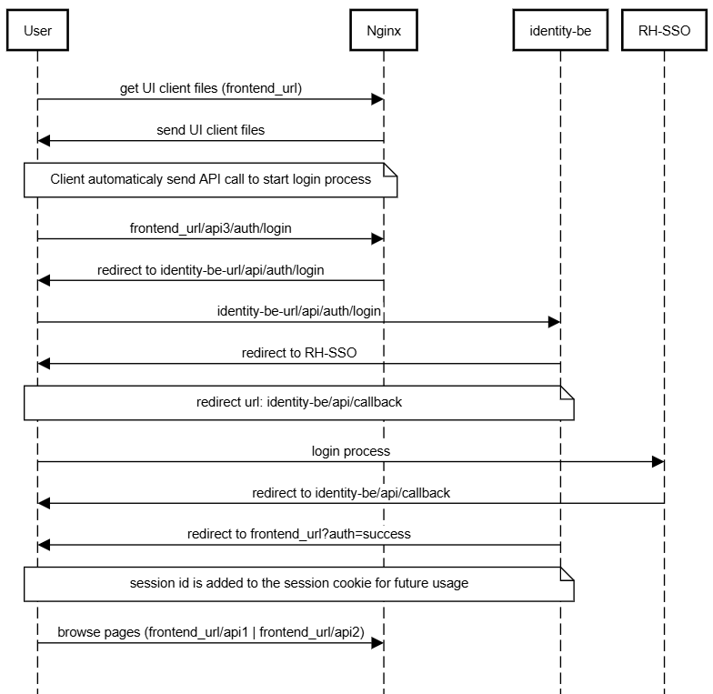

Below is the flowchart of the authentication flow.

A few notes:
1. 2 routes are being used, one for the main app and one for the identity pod
2. currently we only used directly a flask server with the auth manager.





the flow chart was created using the site [sequencediagram](https://sequencediagram.org/)
the chart text is below:


```
Unifai Authentication process

User->Nginx: get UI client files (frontend_url)
Nginx->User: send UI client files
note over User,Nginx:Client automaticaly send API call to start login process
User->Nginx: frontend_url/api3/auth/login
Nginx->User: redirect to identity-be-url/api/auth/login
User->identity-be: identity-be-url/api/auth/login
identity-be->User: redirect to RH-SSO
note over User,identity-be:redirect url: identity-be/api/callback
User->RH-SSO: login process
RH-SSO->User: redirect to identity-be/api/callback
identity-be->User: redirect to frontend_url?auth=success
note over User,identity-be: session id is added to the session cookie for future usage
User->Nginx: browse pages (frontend_url/api1 | frontend_url/api2)
```

When the user logs in to the system he the identity pods gets all user information from the Keycloak server. once the session is authenticated all used information is saved to Redis. Each session gets a random session id which is sent by the ui from now on till the session is expires or the user logs out.
Each component in the system that is access by an API gets that cookie and can extract the session id in order to extract its details from the Redis server.


## Logout and login (GENIE-827)

- **`POST /api/auth/logout`** — Clears the server-side session and cookie, and **best-effort** calls Keycloak’s **OpenID Connect logout** with the stored **refresh token** so the SSO session can be ended server-side, not only in the browser.
- **Login page** — The UI serves **`/login`** with a single **SSO** action; that route is outside the authenticated shell so users can open it while logged out.


logout action (manual):

curl ${KEYCLOACK_BASE_URL}/realms/${KEYCLOACK_REALM}/protocol/openid-connect/logout \
-d client_id=$CLIENT_ID \
-d client_secret=$CLIENT_SECRET \
-d refresh_token=$REFRESH_TOKEN

## Caller authentication

Team, directory and `identity.resolve` routes require an authenticated caller:
either a browser session (cookie) or a trusted internal service presenting the
shared secret.

| Variable | Used by | Purpose |
|----------|---------|---------|
| `INTERNAL_AUTH_SECRET` | identity, multi-agent, rag, backend | Shared secret sent in `X-Internal-Auth` by service-to-service callers; `X-Authenticated-User` is honoured only with a matching secret. Use the same value everywhere. |
| `UNIFAI_DEV_MODE` | all | Set to `true` for local development only: trusts `X-Authenticated-User` without the secret and allows the permissive dev identity provider. |

With a session, team ownership and membership are derived from the session user;
`createdBy` / `requestedBy` are only read from internal service callers.

## Directory providers

`DIRECTORY_PROVIDER` selects where users and groups come from: `ldap` or
`oidc-claims` (empty disables the directory).

### `oidc-claims`

Groups are read from the claims of the user's access token, so an OIDC
group (for example the Keycloak group `/team-a`) can be a team member
source without any LDAP server.

| Variable | Default | Meaning |
|---|---|---|
| `DIRECTORY_OIDC_CLAIM` | `groups` | Claim holding the group list. A dotted path such as `realm_access.roles` is resolved when no claim has that exact name. |
| `DIRECTORY_OIDC_USERNAME_CLAIM` | `preferred_username` | Claim that must equal the user being queried. |
| `DIRECTORY_OIDC_GROUP_PREFIX` | empty | Removed from the start of each group (after the leading `/`). |
| `DIRECTORY_OIDC_LOWERCASE` | `false` | Lower-case group ids. Case is preserved by default. |
| `DIRECTORY_OIDC_JWKS_URL` | **required** | JWKS endpoint used to verify token signatures, e.g. `https://<keycloak>/realms/<realm>/protocol/openid-connect/certs`. |
| `DIRECTORY_OIDC_ISSUER` | **required** | Expected `iss`, e.g. `https://<keycloak>/realms/<realm>`. |
| `DIRECTORY_OIDC_AUDIENCE` | empty | Expected `aud`; checked only when set. |

**Claim format.** A list of strings (a single string is accepted). Keycloak's
"Group Membership" mapper emits full paths: `["/team-a", "/org/team-b"]`.
Group ids are normalised by trimming whitespace and the leading `/`:
`team-a`, `org/team-b`. Non-string and empty entries are ignored.

**Referencing a group in a team.** Add a member `{"type": "group", "id":
"team-a"}` using the normalised id. A user belongs to the team when their
token carries that group; the UI/API passes the user's group ids (from
`/api/auth/user/groups`) when listing teams.

**Limitations.** A token only describes one user, so the provider supports
the calling user's groups (`get_user_groups`, `get_group`, `search_groups`
over those groups) and nothing else:

- `search_users` returns an empty list (logged); users cannot be enumerated.
- Group member lists cannot be produced, so `DirectoryGroup.members` is
  empty and stored `group_members` snapshots are never refreshed from this
  provider (the member count shown for such a group stays as stored).
- Group changes are picked up at the next login or cache refresh
  (`USER_GROUPS_CACHE_TTL`, `/api/auth/user/groups?fresh=1`).

**Security.** Tokens are always verified; there is no unverified mode. The
provider refuses to start (clear error at startup) unless
`DIRECTORY_OIDC_JWKS_URL` and `DIRECTORY_OIDC_ISSUER` are set. Signature,
`exp` (required) and `iss` are checked, plus `aud` when configured. Only
`RS256` and `ES256` are accepted, never `none` or HMAC. Keys are cached for
five minutes. Any failure (bad signature, expired token, wrong issuer, JWKS
unreachable) fails closed: no groups are returned and the reason is logged
as a warning. Nothing client-supplied is trusted. A token whose username
claim differs from the requested user is ignored, and the token is held per
thread so it cannot leak between requests.
